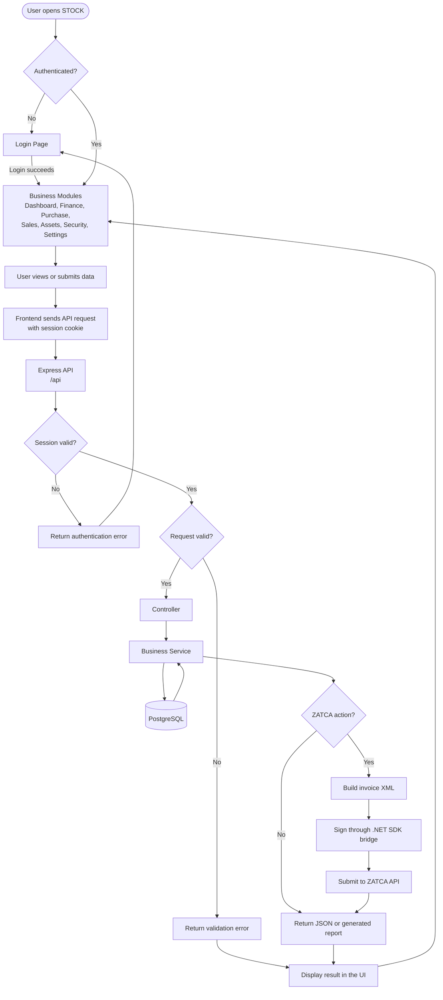
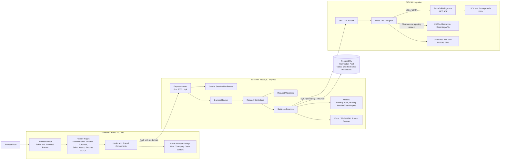
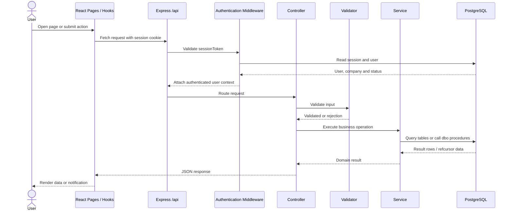
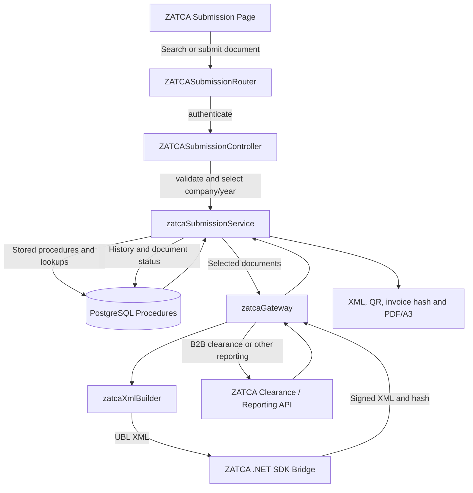

# STOCK Project Architecture

## Application Flowchart

## System Architecture

## Request Flow

## ZATCA Submission Flow

## Backend Package Structure

| Area | Responsibility |
|---|---|
| `routes/` | Maps `/api` HTTP paths to routers and middleware |
| `controller/` | HTTP input/output coordination |
| `validators/` | Input validation and validation errors |
| `services/` | Business logic, SQL operations, reports and integrations |
| `middleware/` | Session authentication and request context |
| `DB/db.ts` | PostgreSQL connection pool |
| `utils/` | Shared posting, audit, formatting and document helpers |
| `zatca-bridge/` | Windows .NET executable and signing SDK dependencies |

## Frontend Package Structure

| Area | Responsibility |
|---|---|
| `src/pages/` | Route-level screens grouped by business module |
| `src/components/` | Reusable and transaction-specific UI |
| `src/hooks/` | API calls and reusable state behavior |
| `src/routes/` | Public, protected and application routing |
| `src/utils/` | Session, API and shared browser utilities |
| `src/config/` | Menu and application configuration |

## Main Business Domains

- Administration: companies, branches, years and documents
- Finance: chart of accounts, journals, receipts, payments, matching and reports
- Purchase: suppliers, items, stock, purchase invoices and purchase reports
- Sales: invoices, stock transfers, adjustments, price lists and sales reports
- Assets: purchases, depreciation, schedules and disposal
- Security: users, login audit, transaction audit and branch/menu permissions
- Settings and utilities: periods, posting accounts, document numbers, backup and year close
- ZATCA: electronic invoice submission, document status, PDF/A3 generation and document paths

## Runtime Configuration

- Frontend development URL: Vite, normally `http://localhost:5173`
- Backend API base: Express on port `5000`, mounted at `/api`
- Frontend API URL: `VITE_API_URL`
- PostgreSQL: `DBHOST`, `DBPORT`, `DATABASE`, `DBUSER` and `PASSWORD`
- ZATCA bridge: `ZATCA_BRIDGE_EXE` or `./zatca-bridge/ZatcaSdkBridge.exe`
- Cross-origin requests allow the local frontend and configured network frontend origins and include credentials.
